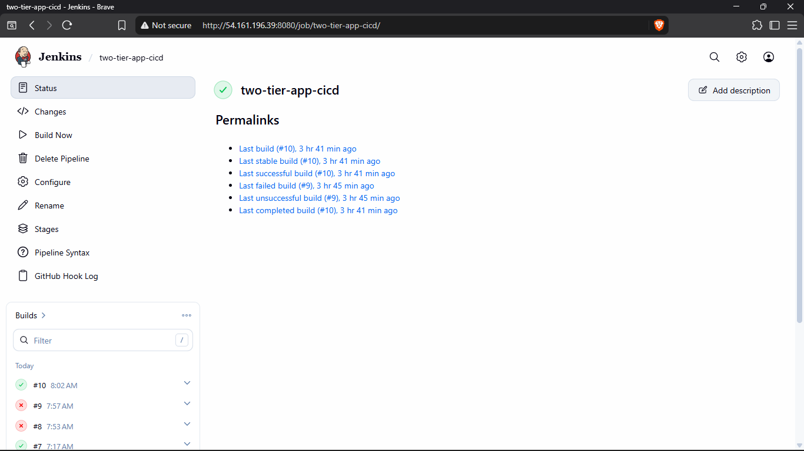

# Two-Tier App: Jenkins CI/CD on AWS EC2

This repository contains a Node.js/Express application with a PostgreSQL database. The included Jenkins pipeline checks out the source, builds and pushes a Docker image, then deploys the app and database to a separate EC2 instance using Docker Compose.

## Deployment Overview

| Instance | Purpose | Required software |
| --- | --- | --- |
| Jenkins EC2 | Jenkins controller; checks out the repository, builds the image, and pushes it to Docker Hub | Jenkins, Java, Git, Docker Engine and Docker Compose plugin |
| Deployment EC2 | Jenkins SSH agent; runs Docker Compose to serve the application | Java, Docker Engine and Docker Compose plugin |

The web application listens on port `3000`. Docker Compose also starts PostgreSQL and persists its data in a named volume.

> **Important:** The checked-in `JenkinsFile` contains example-specific values: a GitHub repository URL, Jenkins credential IDs, a Docker Hub image name, the branch `main`, the agent label `app-instance`, and the deployment path `/home/ubuntu/app`. Update these for your own accounts and instances before running the pipeline.

## 1. Create Two EC2 Instances

Create two Ubuntu EC2 instances in the same AWS region and preferably the same VPC. For a small test deployment, a general-purpose instance with at least 2 GB of memory is a reasonable starting point for Jenkins; size both instances for your workload.

1. Name one instance **jenkins** and the other **deployment**.
2. Create or select an EC2 key pair for your administrative SSH access. Keep its private key secure; do not commit it to this repository.
3. Configure security groups:
	- Allow SSH (`22`) to the Jenkins instance only from your administrator IP.
	- Allow SSH (`22`) to the deployment instance from the Jenkins instance's security group. Keep administrator SSH access only if you need it.
	- Allow Jenkins web access (`8080`) only from trusted administrator IPs, or put Jenkins behind an HTTPS reverse proxy.
	- Allow application traffic (`3000`) to the deployment instance from the clients that should access the app. For a public demo, this can be `0.0.0.0/0`; restrict it for non-public deployments.
	- Do not expose PostgreSQL port `5432` publicly. The database is only used by the app over the Compose network.
4. Use the deployment instance's private IP as the Jenkins agent host when both instances are in the same VPC. A private IP avoids exposing agent SSH to the internet.


## 2. Install Jenkins and Docker on the Jenkins Instance

Connect to the Jenkins instance over SSH. Install a supported Java runtime and Git, then install Jenkins using the official instructions for your Ubuntu release:

```bash
sudo apt update
sudo apt install -y fontconfig openjdk-21-jre git
java -version
```

Follow the current [Jenkins Linux installation guide](https://www.jenkins.io/doc/book/installing/linux/) to add the Jenkins package repository and install/start Jenkins. Open `http://JENKINS_PUBLIC_IP:8080` from an allowed administrator IP and complete the initial setup wizard.

Install Docker Engine and the Docker Compose plugin by following the official [Docker Engine on Ubuntu guide](https://docs.docker.com/engine/install/ubuntu/). Verify both commands are available:

```bash
docker --version
docker compose version
```

The pipeline builds and pushes the image on the Jenkins controller, so Docker must run there. Configure Docker Hub credentials in Jenkins in a later step.


## 3. Add Jenkins to the Docker Group

The Jenkins service user needs permission to access the Docker socket on the Jenkins instance:

```bash
sudo usermod -aG docker jenkins
sudo systemctl restart jenkins
```

Confirm Jenkins can use Docker. One way is to run a test build from a Jenkins job or, after restarting the service, check that the `jenkins` account belongs to the `docker` group:

```bash
id jenkins
```

The deployment agent user also needs Docker access on the deployment instance; configure that in Step 5. Membership in the Docker group effectively grants root-level control of that host. Only add trusted users and protect Jenkins accordingly.


## 4. Create a GitHub Token and Jenkins Credentials

If the repository is private, Jenkins needs a GitHub token to clone it. Create a token in GitHub under **Settings → Developer settings → Personal access tokens**. Prefer a fine-grained token scoped to this repository with **Contents: Read-only** permission. If using a classic token, grant the minimum repository access needed (for private repositories, the `repo` scope is commonly required). Set an expiration and rotate the token when it expires.

In Jenkins, open **Manage Jenkins → Credentials → System → Global credentials → Add Credentials** and add:

1. **GitHub repository credential:** Kind **Username with password**; use your GitHub username and the token as the password. Choose an ID, for example `github-token`.
2. **Docker Hub credential:** Kind **Username with password**; use your Docker Hub username and an access token/password. Choose an ID, for example `dockerhub-credentials`.

Do not put tokens or passwords in the `JenkinsFile`, Git history, or screenshots. Credentials are referenced by ID in the pipeline.

The current `JenkinsFile` uses credential IDs `github-tocken` (spelling as currently written) and `a19bd62e-8705-46a6-8464-e107cbfdb9c2`. Either create credentials with those exact IDs, or change the `credentialsId` values in the `JenkinsFile` to the IDs you chose above. Also change the GitHub URL and Docker Hub image name in that file to your repository and image.


## 5. Prepare the Deployment Instance as a Jenkins SSH Agent

Connect to the deployment instance over SSH. Install Java and Docker Engine with the Compose plugin, following the same Docker guide linked in Step 2. Jenkins needs Java on the agent to launch its remoting process.

The pipeline uses `/home/ubuntu/app` as its deployment directory and the SSH agent must run as `ubuntu` for this path. Prepare the directory and Docker permissions:

```bash
sudo usermod -aG docker ubuntu
sudo mkdir -p /home/ubuntu/app
sudo chown -R ubuntu:ubuntu /home/ubuntu/app
```

Log out and back in (or restart the instance) for the Docker group membership to take effect. Verify `ubuntu` can run `docker ps` and `docker compose version` without `sudo`.

On the Jenkins instance, create a dedicated SSH key pair for Jenkins-to-deployment access. Do not reuse or commit your personal EC2 key.

```bash
ssh-keygen -t rsa
```
keep pressing enter for the prompts (which leaves the passphrase empty)

copy the public key of the Jenkins instance to the Deployment instance

```bash
cat ~/.ssh/id_rsa.pub
```

In Jenkins credentials, add the **private** key as **SSH Username with private key**. Set username to `ubuntu`, paste the private key contents, and choose an ID such as `deployment-ssh-key`. Never copy the private key to the deployment instance.

```bash
cat ~/.ssh/id_rsa
```

Install the **SSH Build Agents** plugin in Jenkins if it is not already installed. Go to **Manage Jenkins → Nodes → New Node**, create a permanent agent, and configure:

- **Node name:** `deployment-agent` (or another name)
- **Remote root directory:** `/home/ubuntu/jenkins-agent`; create it on the deployment instance and grant `ubuntu` ownership:

	```bash
	sudo mkdir -p /home/ubuntu/jenkins-agent
	sudo chown ubuntu:ubuntu /home/ubuntu/jenkins-agent
	```

- **Labels:** `app-instance` (must match the pipeline)
- **Launch method:** Launch agents via SSH
- **Host:** deployment instance's private IP or DNS name
- **Credentials:** the SSH private-key credential created above
- **Host Key Verification Strategy:** use a secure known-hosts strategy for your environment; avoid disabling verification in production

Save the node and confirm it comes online. If using different node labels, update `agent { label 'app-instance' }` in the `JenkinsFile` to match.


## 6. Update the Pipeline for Your Repository and Image

Before creating the job, edit `JenkinsFile` in your clone and update:

- The `git` step URL to your GitHub clone URL and the branch name if it is not `main`.
- The GitHub `credentialsId` to the ID of your repository credential.
- The Docker Hub `credentialsId` to the ID of your Docker credential.
- The image name in both `docker build` and `docker push` to your Docker Hub repository.
- The deployment stage label if you chose a different agent label.
- The directory in `dir('/home/ubuntu/app')` if your deployment path differs.

For example, use the same image name in the build, push, and `image:` field of `docker-compose.yml`. The current Compose file maps host port `3000` to container port `3000` and uses `postgres:17-alpine` for the database.

## 7. Create a Jenkins Pipeline Job

1. In Jenkins, select **New Item**, enter a job name, choose **Pipeline**, then select **OK**.
2. Under **Build Triggers**, select **GitHub hook trigger for GITScm polling**.
3. Under **Pipeline**, choose **Pipeline script from SCM**.
4. Set SCM to **Git**, enter the repository URL, select the GitHub credential, and set the branch (for example, `*/main`).
5. Set **Script Path** to `JenkinsFile` (capitalization matters), then save.

The pipeline itself also performs a checkout using the values in the `JenkinsFile`; keep the job SCM settings and pipeline checkout pointed at the same repository and branch.

## 8. Configure a GitHub Webhook

GitHub must be able to reach the Jenkins webhook endpoint. Use a stable public DNS name and HTTPS for a real deployment. Do not expose an unsecured Jenkins instance broadly to the internet.

1. In GitHub, open your repository and go to **Settings → Webhooks → Add webhook**.
2. Set **Payload URL** to `http://YOUR_JENKINS_HOST/github-webhook/` (include the trailing slash).
3. Set **Content type** to `application/json`.
4. Optionally set a long random **Secret** and configure the matching webhook secret in Jenkins/GitHub integration. Do not use a GitHub personal access token as the webhook secret.
5. Select **Just the push event** and ensure the webhook is active.
6. Save, then check **Recent Deliveries** in GitHub. A successful request should receive an HTTP success response from Jenkins.

For a temporary lab without HTTPS, Jenkins can be reached over HTTP at `http://JENKINS_PUBLIC_IP:8080/github-webhook/`, but restrict access to trusted source addresses and do not use this as a production configuration.


## 9. Run and Verify the Deployment

1. In Jenkins, open the pipeline job and select **Build Now** for the first run.
2. Follow **Console Output**. The expected stages are **Checkout Code**, **Build and Push**, and **Deploy to App Instance**.
3. Confirm the build succeeds and the deployment agent is online. On the deployment instance, check the containers:

	```bash
	cd /home/ubuntu/app
	docker compose ps
	docker logs devops-app
	```

4. From a machine allowed by the deployment instance's security group, open `http://DEPLOYMENT_PUBLIC_IP:3000`. The health endpoint is `http://DEPLOYMENT_PUBLIC_IP:3000/health`.
5. Push a small change to the configured GitHub branch and confirm the webhook starts another Jenkins build.




## Run Locally with Docker Compose

To run the app without Jenkins, clone the repository and start its services:

```bash
git clone https://github.com/YOUR_ACCOUNT/YOUR_REPOSITORY.git
cd YOUR_REPOSITORY
docker compose up -d --build
```

Open `http://localhost:3000`. Check service status with `docker compose ps` and stop the services with `docker compose down`. The PostgreSQL data remains in the `postgres-data` volume; to also delete that data, use `docker compose down -v`.

## Troubleshooting

- **Jenkins cannot run Docker:** verify `jenkins` is in the `docker` group, restart Jenkins, and check Docker Engine is running.
- **SSH agent will not connect:** verify the deployment security group allows SSH from Jenkins, the public key is in `ubuntu`'s `authorized_keys`, the credential uses username `ubuntu`, Java is installed, and the SSH node host key is trusted.
- **Deploy stage cannot run Compose:** verify the node label is `app-instance`, `/home/ubuntu/app` is writable by the SSH agent user, Docker Compose is installed, and that user can run Docker without `sudo`.
- **GitHub checkout fails:** verify the repository URL, branch, credential type, token permissions, and the exact Jenkins credential ID in `JenkinsFile`.
- **Webhook does not start a build:** verify the Jenkins URL is reachable from GitHub, the payload URL ends in `/github-webhook/`, the job trigger is enabled, and GitHub's Recent Deliveries has no connection error.
- **App is unreachable:** verify the pipeline deployed successfully, `docker compose ps` shows both services running, and the deployment security group allows inbound port `3000`.

## Security Notes

- Never commit private keys, GitHub tokens, Docker credentials, or production database passwords.
- Restrict SSH, Jenkins, and application ingress to the smallest practical set of source addresses.
- Use HTTPS for Jenkins webhooks and the Jenkins UI; keep Jenkins and its plugins updated.
- Replace example credentials, image names, and deployment settings with your own values. Rotate credentials periodically.